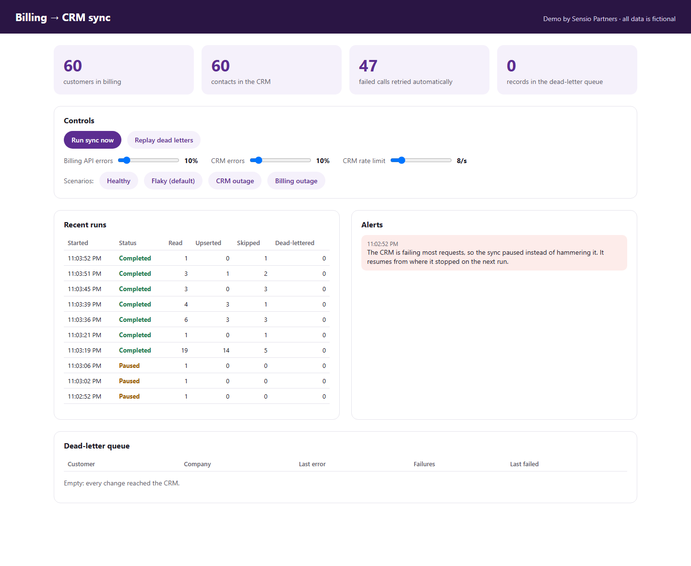
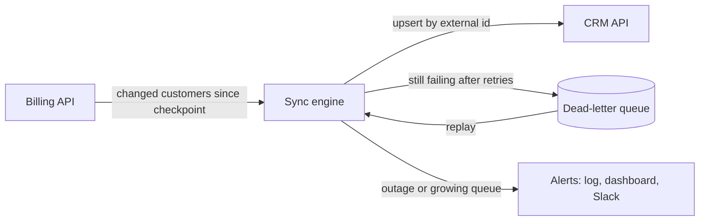

# Billing → CRM sync that survives real-world failures

Most integrations work in the demo and break in production. APIs time out, CRMs rate-limit you, and
one bad record stops the whole job. Then someone finds out weeks later that the sales team has been
working from stale data.

This demo syncs customers from a billing system into a CRM and keeps going when things fail.



## What it does

- **Syncs only what changed.** Each run reads from a checkpoint and skips contacts the CRM already has,
  so running it twice is safe and cheap.
- **Retries transient failures.** Timeouts, 5xx errors, and 429 rate limits are retried with
  exponential backoff and jitter, and `Retry-After` is honored.
- **Isolates bad records.** A record that still fails after retries goes to a dead-letter queue, and
  the rest of the run continues. The queue can be replayed in one click.
- **Backs off when a system is down.** If the CRM fails most requests, a circuit breaker opens and the
  run pauses instead of hammering it. The next run resumes from where it stopped, with nothing lost.
- **Tells someone.** Outages and a growing dead-letter queue raise alerts, deduplicated so a long
  outage doesn't flood the channel. Set a Slack webhook to receive them.
- **Translates between systems.** Billing statuses become CRM lifecycle stages: `active` → `customer`,
  `past_due` → `at-risk`, `canceled` → `churned`.

## Run it

Requires the [.NET 10 SDK](https://dotnet.microsoft.com/download).

```bash
cd crm-sync/src/CrmSync
dotnet run
```

Open <http://localhost:5080>. The first sync starts after a couple of seconds and then runs every
15 seconds. The billing data changes on its own every 5 seconds, as upgrades, failed payments, and
cancellations would.

Use the scenario buttons to see how the sync behaves:

| Scenario | What to look for |
|---|---|
| **Flaky** (default) | The retry counter climbs while every run still completes. |
| **CRM outage** | A few records reach the dead-letter queue, then the circuit opens, the run shows **Paused**, and an alert appears. |
| **Healthy** | After about 15 seconds the circuit closes, the next run catches up, and **Replay dead letters** empties the queue. |
| **Billing outage** | Runs show **Failed** and raise an alert, and the checkpoint stays put until the API is back. |

Run the tests with `dotnet test` from the `crm-sync` folder.

## How it's built



| Concern | Where |
|---|---|
| Retries, timeouts, circuit breaker | [`Program.cs`](src/CrmSync/Program.cs), using `Microsoft.Extensions.Http.Resilience` (Polly) |
| Sync logic, dead-lettering, pause and resume | [`Sync/SyncEngine.cs`](src/CrmSync/Sync/SyncEngine.cs) |
| Field and status mapping | [`Sync/ContactMapper.cs`](src/CrmSync/Sync/ContactMapper.cs) |
| Alerts | [`Sync/Alerts.cs`](src/CrmSync/Sync/Alerts.cs) |
| Simulated billing API and CRM, with adjustable failures | [`Mocks/`](src/CrmSync/Mocks) |
| Tests | [`tests/CrmSync.Tests`](tests/CrmSync.Tests) |

Logs are structured (`ILogger` message templates with a `RunId` scope). To get JSON output, set
`Logging:Console:FormatterName` to `json`.

## From demo to production

The demo keeps everything in one process so it runs with a single command. In a client project:

- The billing API and CRM are the real ones, such as Stripe, Chargebee, HubSpot, or Salesforce, behind
  the same `IBillingClient` and `ICrmClient` interfaces.
- The checkpoint, the last-synced snapshot, and the dead-letter queue live in a database or a queue
  service, not in memory.
- The worker runs as a container or serverless job on AWS or Azure, with metrics and alerts in the
  client's monitoring tool.

---

Built by [Sensio Partners](https://sensiopartners.com). All company names and data in this demo are fictional.
